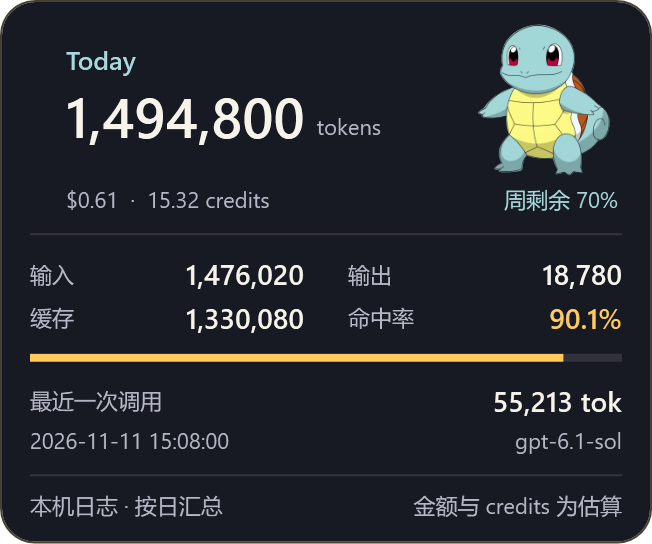

# jieni_token 1.0.0

Windows 上的 ChatGPT / Codex 桌面用量浮窗。打开或切回 ChatGPT 后，浮窗显示当天 Token、美元和 credits 估算，以及每周剩余额度。统计使用本机 Codex 日志。



## 安装和使用

- 在 64 位 Windows 上解压到固定位置后，双击 `Install.cmd`。Windows 登录时会启动浮窗，ChatGPT 在前台时显示。
- 按住卡片顶部拖动，在 ChatGPT 窗口范围内移动。单击顶部展开或收起详情。
- 拖动右下角调整大小，或右键选「调整大小」设置 65% 至 160% 的缩放。小窗口会限制实际显示尺寸。
- 右键菜单可恢复默认位置和大小、更换 PNG / JPEG 头像、恢复杰尼龟、临时隐藏或退出。
- 位置、缩放和头像路径保存在 `%LOCALAPPDATA%\JieniToken\settings.json`。双击 `Uninstall.cmd` 可以停止程序并移除自启动。

## 数据来源

- **Today** 汇总本机日志里的输入和输出，按 Windows 本地日期过午夜重新累计。缓存是输入的一部分，命中率以缓存输入除以总输入。
- **美元与 credits** 是公开费率下的估算。模型费率在 `config/rates.json`。更新费率后重启生效。实际账单以账户为准。[API 费率](https://developers.openai.com/api/docs/pricing) · [ChatGPT credits](https://learn.chatgpt.com/docs/pricing)
- **周剩余** 读取最近一条七天 Codex 通用额度记录，用 100% 减去已用比例。悬停可以查看记录时间和重置时间。日志缺少七天窗口或记录已经到期时显示「—」。切换账户或工作区后，以新写入的记录为准。[Codex 额度字段](https://learn.chatgpt.com/docs/app-server#6-rate-limits-chatgpt)
- 日志目录优先使用 `CODEX_HOME`，默认使用 `%USERPROFILE%\.codex`。程序只读本机会话日志。

## 源码结构

| 目录 | 职责 |
| --- | --- |
| `src/Desktop/` | WPF 入口、显示和交互。界面布局在 `Views/Card.xaml`，头像加载在 `Views/MascotView.cs`，拖动和缩放计算在 `Views/WindowGesture.cs` |
| `src/Core/` | Token、额度和汇总模型、增量汇总、金额计算 |
| `src/Infrastructure/Codex/` | 发现会话文件、增量读取 JSONL、解析周额度 |
| `src/Infrastructure/Configuration/` | 用户设置和费率配置的读写 |
| `src/Infrastructure/Windows/` | Win32 前台窗口识别和 DPI 感知定位 |
| `assets/` 与 `config/` | 内置头像原图和独立费率表 |

依赖由桌面层指向数据读取层和 Core。Core 只处理数据和计算。默认头像的裁剪在 `DefaultMascot.xaml`，右键选择的头像直接按比例显示。

## 开发和发布

先退出正在运行的精灵，在项目根目录打开 PowerShell：

```powershell
.\Build.ps1
Start-Process -FilePath .\CodexTokenPet.exe -ArgumentList '--preview' -Wait
.\Build.ps1 -Test
```

`Build.ps1` 使用 Windows 自带的 64 位 .NET Framework 编译器，将界面和默认头像嵌入 `CodexTokenPet.exe`。布局预览使用示例数据。`-Test` 用构造的会话日志检查跨日、周额度解析和窗口配置。用 `--report` 可以把本机用量和窗口诊断写入临时目录，便于本地排查。

向 GitHub 提交修改时，将源码、资源、配置和脚本放入仓库。发布附件可包含编译好的 EXE、配置目录和安装脚本。提交交互改动时可以附一张预览，并说明测试过的拖动、缩放和重启场景。
